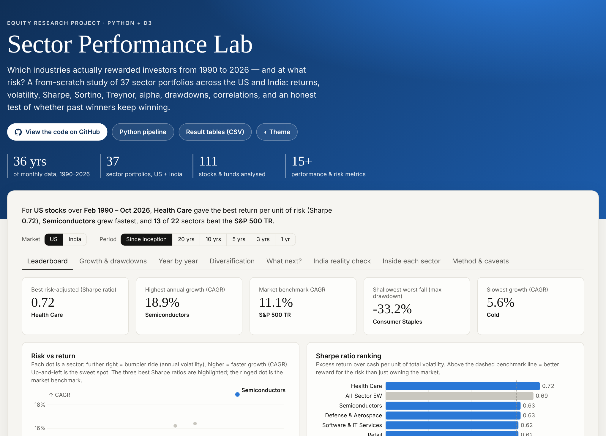
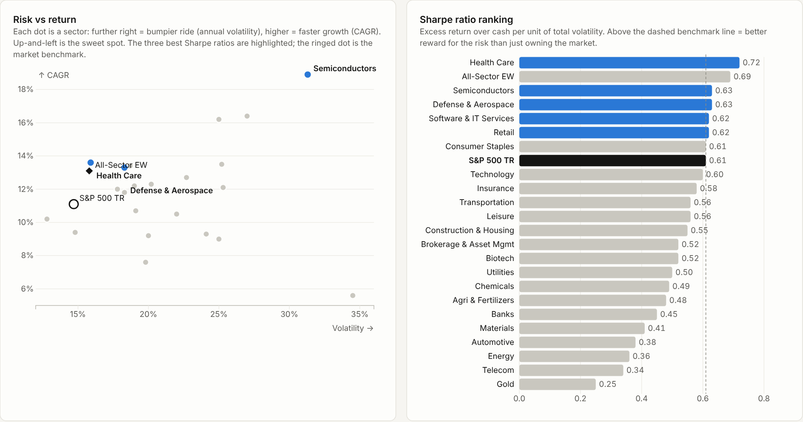
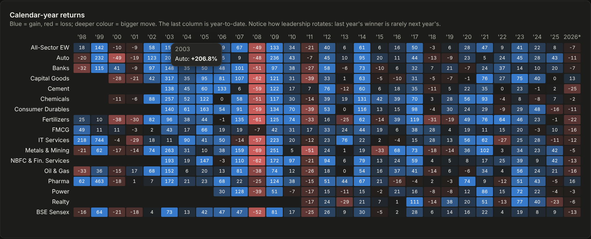
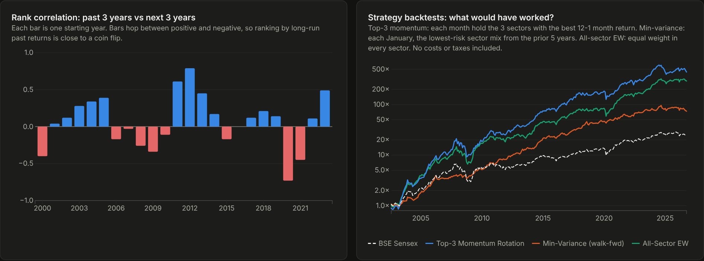
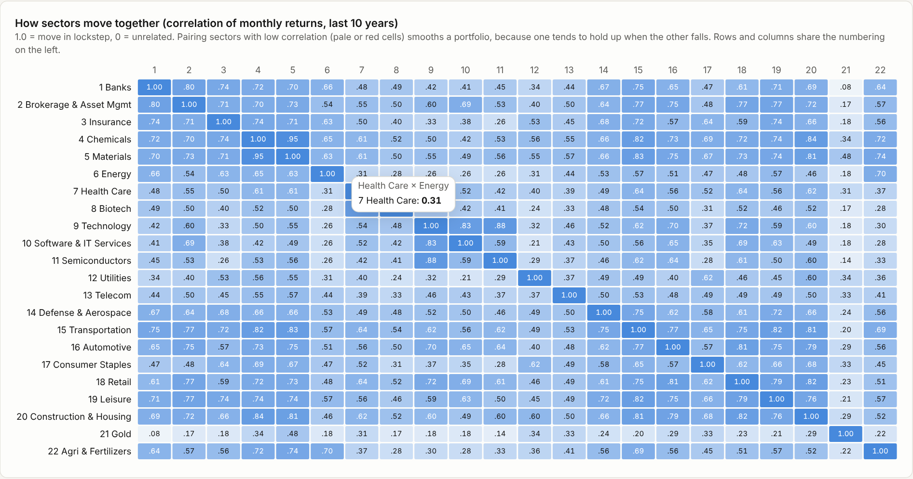
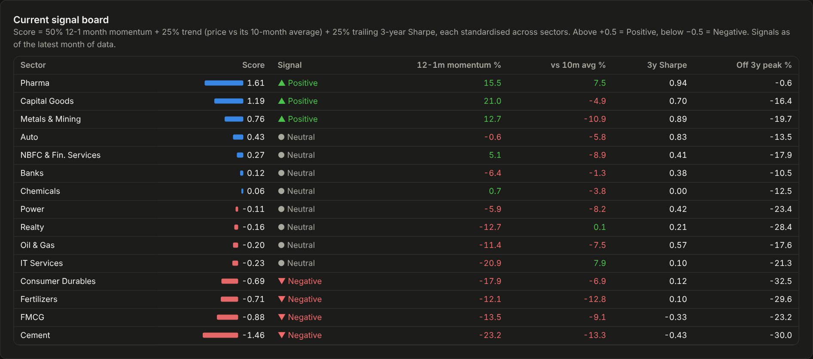
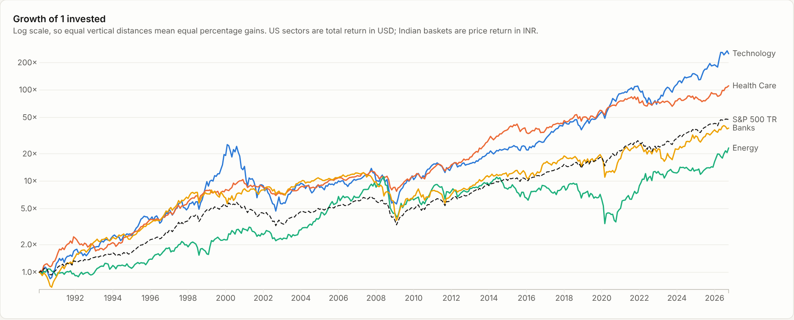
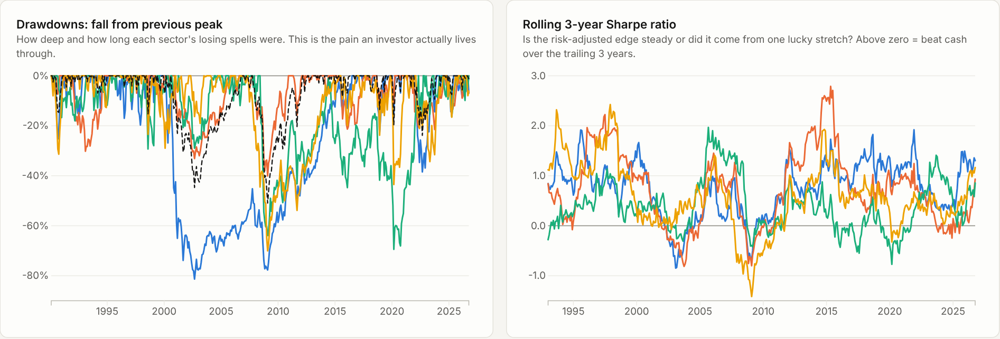
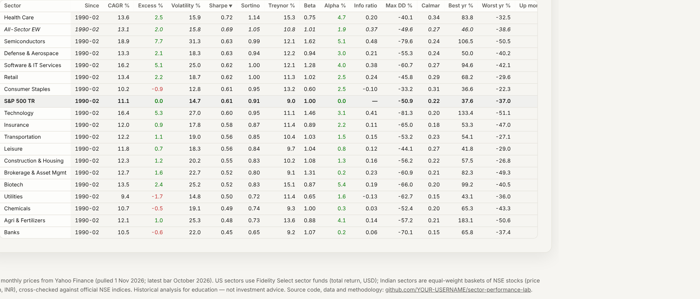
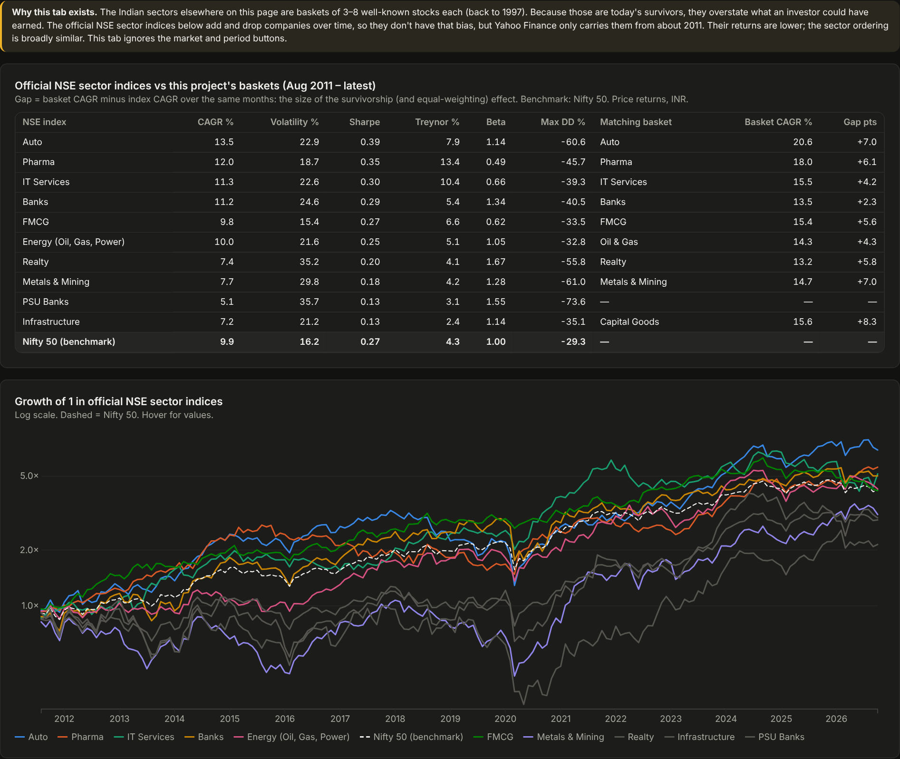

<div align="center">

# 📈 Sector Performance Lab

### Which industries actually rewarded investors from 1990 to 2026, and at what risk?

**[🔗 Open the live interactive dashboard](https://palakgupta7456.github.io/sector-performance-lab/)**


[](https://palakgupta7456.github.io/sector-performance-lab/)

</div>

---

## What this project does

This project builds **37 sector portfolios** across two markets from raw monthly price data and scores each one on return, risk and risk-adjusted performance:

- 🇺🇸 **US:** 22 sectors, Feb 1990 – Oct 2026 (banks, chemicals, semiconductors, agri & fertilizers and more)
- 🇮🇳 **India:** 15 sectors, Aug 1997 – Oct 2026 (built from 85 NSE stocks, including dedicated **Chemicals** and **Fertilizers** baskets)

It then asks the question investors care about most: **does past sector performance tell you anything about the future?**

Everything is published as an interactive dashboard (GitHub Pages, D3.js), and every step is reproducible from the Python pipeline in [`src/`](src).

| | |
|---|---|
| **Returns** | CAGR, total return, calendar-year returns, decade returns, excess return vs benchmark |
| **Risk** | Annualised volatility, max drawdown, downside deviation, beta, tracking error, VaR & CVaR (95%), skew |
| **Risk-adjusted** | **Sharpe**, **Sortino**, **Treynor**, **Jensen's alpha**, **Information ratio**, **Calmar**, up/down capture |
| **Dynamics** | Rolling 3-year Sharpe, drawdown paths, 10-year correlation matrix |
| **Forward-looking** | Momentum/trend signal board, past-vs-future rank persistence test, strategy backtests |
| **Robustness** | Survivorship-bias check against official NSE sector indices, transparent data cleaning log |

---

## Key findings

### 1. Long-run leaders differ by market, and "fastest growth" ≠ "best for the risk"



**US, 1990–2026** (S&P 500 TR: 11.1% CAGR, Sharpe 0.61)

| Sector | CAGR | Volatility | Sharpe | Treynor | Beta | Max drawdown |
|---|---:|---:|---:|---:|---:|---:|
| **Health Care** | 13.6% | 15.9% | **0.72** | 15.3% | 0.75 | −40% |
| **Semiconductors** | **18.9%** | 31.3% | 0.63 | 12.1% | 1.62 | −80% |
| Defense & Aerospace | 13.3% | 18.3% | 0.63 | 12.2% | 0.94 | −55% |
| Software & IT Services | 16.2% | 25.0% | 0.62 | 12.1% | 1.28 | −61% |
| Consumer Staples | 10.2% | 12.8% | 0.61 | 13.2% | 0.60 | **−33%** |
| *…* | | | | | | |
| Energy | 9.0% | 25.0% | 0.36 | 9.6% | 0.95 | −69% |
| Telecom | 7.6% | 19.8% | 0.34 | 6.7% | 0.99 | −80% |

- **Semiconductors** compounded fastest (≈570× since 1990), but it had to survive an 80% crash.
- **Health Care** earned the best Sharpe ratio with **below-market beta**.
- **Consumer Staples** was the smoothest ride (shallowest drawdown).

**India, 1997–2026** (BSE Sensex: 10.2% price CAGR)

| Sector | CAGR | Sharpe | Beta | Max drawdown |
|---|---:|---:|---:|---:|
| **Consumer Durables** | 31.4% | **0.87** | 1.07 | −66% |
| **Chemicals** | **31.9%** | 0.80 | 1.05 | −59% |
| NBFC & Fin. Services | 31.6% | 0.80 | 1.28 | −70% |
| Pharma | 29.2% | 0.79 | 0.75 | −40% |
| *…* | | | | |
| **Fertilizers** | 16.3% | 0.41 | 1.05 | −70% |
| Realty | 12.7% | 0.33 | 1.41 | −51% |

> ⚠️ Indian basket returns are inflated by **survivorship bias**. Against official NSE sector indices since 2011, the baskets overstate CAGR by roughly 3–8 points a year, but the *ranking* of sectors largely holds (correlation 0.85–0.98). See [the reality-check tab](https://palakgupta7456.github.io/sector-performance-lab/#nse).

### 2. Leadership rotates constantly



Last year's winner is rarely next year's. Even the steadiest sectors had bad years: US Consumer Staples' worst was −22% and India FMCG's −16%. Most sectors had at least one year worse than −30%.

### 3. Past winners carry only a weak edge forward



Every year, I ranked sectors by their **past 3-year return** and compared that ranking with their **next 3-year return**:

| | Avg. rank correlation | Past top-3, next 3y | Past bottom-3, next 3y | Top-3 beat bottom-3 |
|---|---:|---:|---:|---:|
| US | **0.04** | +53% | +41% | 58% of periods |
| India | **0.07** | +126% | +102% | 50% of periods |

A correlation near zero means **long-run past performance is close to a coin flip as a predictor.**

Shorter-term **momentum** (the last 12 months, skipping the most recent one) did add value, net of nothing (no costs or taxes):

| Strategy (monthly) | US CAGR / Sharpe | India CAGR / Sharpe |
|---|---|---|
| Top-3 momentum sector rotation | **18.5% / 0.78** | **28.5% / 0.87** |
| Equal-weight all sectors | 12.8% / 0.68 | 26.4% / 0.86 |
| Walk-forward minimum variance | 10.5% / 0.63 (max DD −35%) | 19.4% / 0.81 (max DD **−23%**) |
| Benchmark | 11.2% / 0.62 | 14.2% / 0.45 |

### 4. Diversification works, but less in a crash



Over the last 10 years, Indian **IT Services** and **Pharma** had the lowest correlation with other sectors (≈0.1–0.4), making them the best diversifiers. Financials, capital goods and metals moved largely together.

### 5. What the signals say now (as of Oct 2026)



- **Positive momentum and trend:**
  - 🇺🇸 Energy, Semiconductors, Technology, Biotech, Health Care
  - 🇮🇳 Pharma, Capital Goods, Metals & Mining
- **Weakest:**
  - 🇺🇸 Automotive, Construction & Housing, Utilities
  - 🇮🇳 Cement, FMCG, Fertilizers, Consumer Durables

These are evidence-based signals, **not forecasts**. Finding #3 is the reason to hold them loosely.

---

## More from the dashboard

| Growth of 1 (log scale) | Drawdowns & rolling Sharpe |
|---|---|
|  |  |

| Full metrics table (sortable) | Survivorship-bias check |
|---|---|
|  |  |

---

## Methodology

**Data.** Monthly dividend- and split-adjusted prices from Yahoo Finance's public chart API, pulled on 1 Nov 2026; the latest bar is October 2026. The raw responses are committed in [`data/raw/`](data/raw) so results are fully reproducible offline.

**US sector portfolios.** Each sector is proxied by a **Fidelity Select sector fund**: real, investable, professionally managed portfolios of the stocks in one industry, with **total-return** history back to the 1980s. "Agri & Fertilizers" has no long-lived fund, so it is an equal-weight basket of Mosaic, CF Industries, Nutrien, ADM and Deere.
- Benchmark: S&P 500 Total Return.
- Risk-free rate: 13-week US T-bill (^IRX).

**Indian sector portfolios.** Each sector is an **equal-weighted, monthly-rebalanced basket** of 3–8 established NSE stocks (85 in total). Stocks join the basket when their price history begins.
- Benchmark: BSE Sensex.
- Risk-free rate: approximate annual 91-day T-bill yields (RBI).
- Price returns on both sides.

**Data cleaning.** 190 Indian stock-months were excluded and logged ([`flags`](docs/data/flags.json)). Most are spike-and-reverse errors from mishandled stock splits (for example, +1,300% one month and −90% the next); the rest are each stock's first 2 listed months.

**Metric definitions**

| Metric | Formula / meaning |
|---|---|
| CAGR | (Ending value ÷ starting value)^(1/years) − 1 |
| Volatility | Std. dev. of monthly returns × √12 |
| Sharpe | Annualised excess return over T-bills ÷ volatility |
| Sortino | Annualised excess return ÷ downside deviation |
| Treynor | Annualised excess return ÷ beta |
| Beta | Cov(sector excess, market excess) ÷ Var(market excess) |
| Jensen's alpha | Excess return − beta × market excess return |
| Information ratio | Mean active return ÷ tracking error |
| Max drawdown / Calmar | Worst peak-to-trough fall; CAGR ÷ \|max drawdown\| |
| Up / down capture | Avg. sector return in market up (down) months ÷ market's |
| VaR / CVaR 95% | 5th-percentile monthly return / mean of returns below it |

**Strategies.**
- *Momentum rotation*: each month, hold the 3 sectors with the highest trailing 12-1 month return.
- *Minimum variance*: each January, a long-only portfolio minimising variance on the prior 60 months (projected gradient descent), with no look-ahead.

**Limitations.**
- Survivorship bias in the Indian baskets.
- The US fund proxies carry fees of about 0.7% a year.
- USD and INR results are not directly comparable.
- Backtests exclude costs and taxes.
- This is a historical study, **not investment advice**.

---

## Project structure

```
sector-performance-lab/
├── src/
│   ├── universe.py           # every ticker, grouped by market and role
│   ├── fetch_data.py         # 1. download monthly prices (Yahoo Finance) → data/raw/
│   ├── build_prices.py       # 2. raw JSON → data/prices_monthly.csv
│   ├── analysis.py           # 3. sector portfolios, all metrics, rolling stats, tests, backtests → outputs/
│   ├── export_dashboard.py   # 4. tidy JSON datasets for the dashboard → docs/data/
│   └── build_site.py         # 5. assemble the static site → docs/index.html
├── site_src/                 # dashboard source (D3.js charts + page shell)
├── data/                     # raw API responses + cleaned monthly price table
├── outputs/                  # result tables (CSV): metrics, returns, signals, backtests
├── docs/                     # the live GitHub Pages site
├── images/                   # README screenshots
└── run_all.sh                # one command to rebuild everything
```

## Run it yourself

```bash
git clone https://github.com/PalakGupta7456/sector-performance-lab.git
cd sector-performance-lab
pip install -r requirements.txt

./run_all.sh                         # rebuild everything from the committed raw data
python src/fetch_data.py --refresh   # optional: pull fresh prices first

# preview the dashboard locally
python -m http.server -d docs 8000   # → http://localhost:8000
```

Want to add a sector? Add its tickers to `src/universe.py` and the sector map at the top of `src/analysis.py`, then run `./run_all.sh`.

---

## Tech stack

**Python** (pandas, NumPy) for data engineering and quantitative analysis · **D3.js v7** for the interactive visualisations · **GitHub Pages** for hosting. No frameworks, no build step: the site is a single static HTML file plus JSON data.

<div align="center">

*Built by [Palak Gupta](https://github.com/PalakGupta7456) · Historical analysis for education and research, not investment advice.*

</div>
